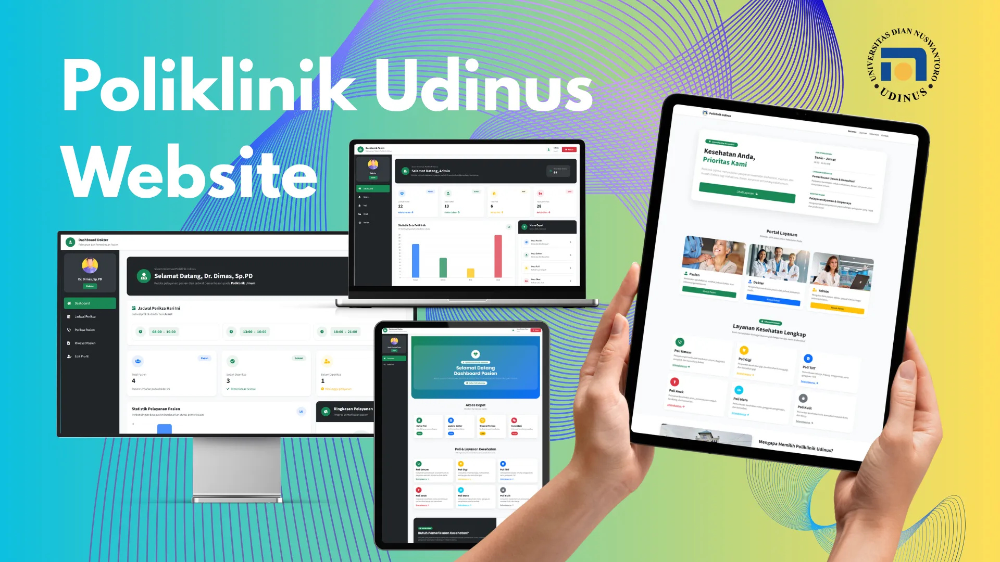
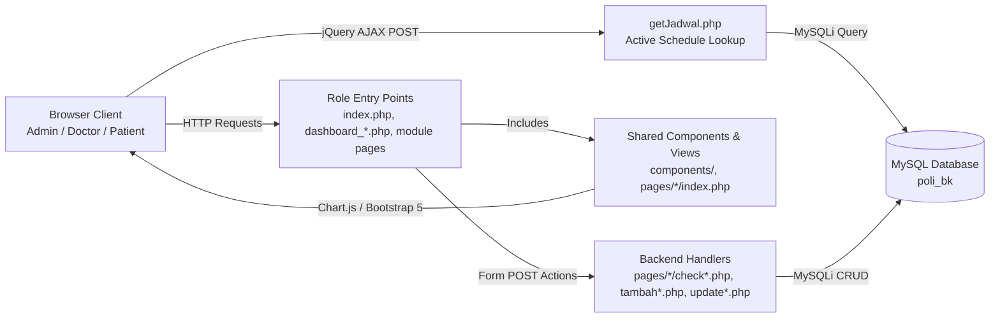
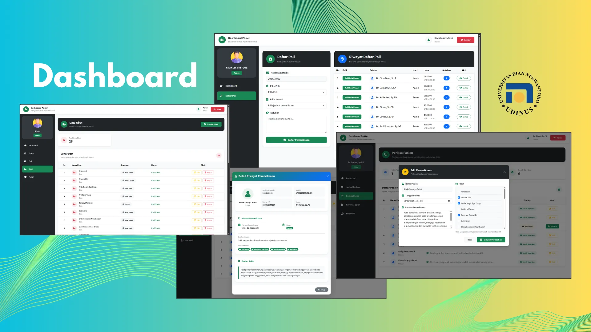
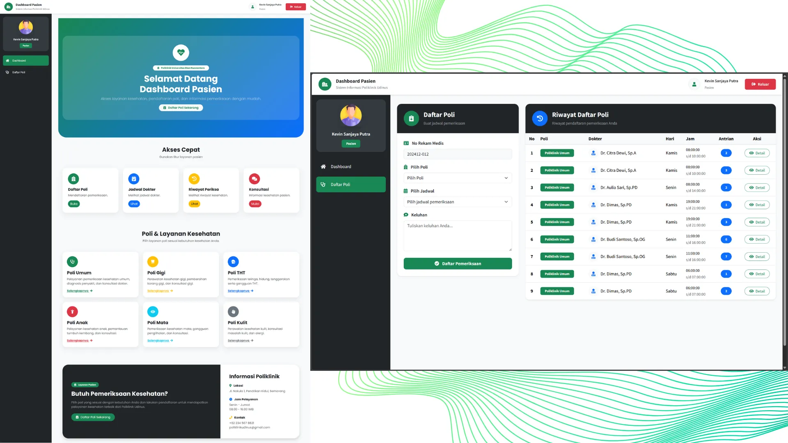
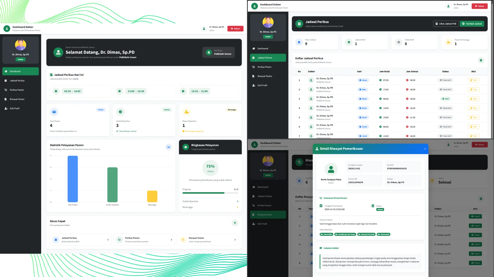
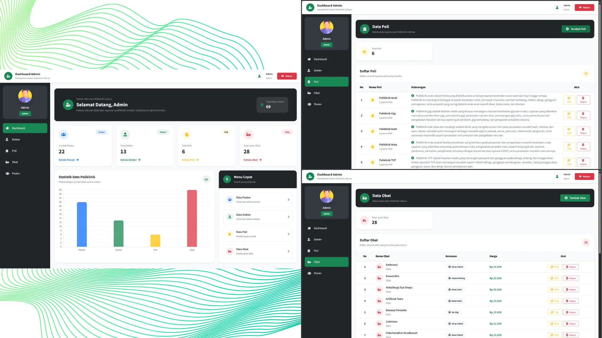

# Poliklinik Udinus




## Project Overview

Poliklinik Udinus is a full-stack web-based clinic management and outpatient appointment system built to digitize polyclinic operations for Universitas Dian Nuswantoro. It streamlines patient registration, medical record number (`no_rm`) generation, doctor practice scheduling, real-time queue numbering, clinical examinations, and prescription billing across three dedicated portals for Administrators, Doctors, and Patients. By replacing manual paper logs with a centralized relational MySQL database and role-based dashboards, the application improves appointment coordination, billing accuracy, and clinical record traceability.

## Key Features

- **Public Clinic Landing Portal**: Presents Poliklinik Udinus operational hours, six specialized polyclinic services (General, Dental, Pediatric, Eye, ENT, and Dermatology), doctor directories, and direct login entry points for each user role.
- **Patient Self-Registration & Medical Record Numbering**: Registers new patients with National ID (`no_ktp`) duplication checks and automatically generates sequential `YYYYMM-XXX` medical record numbers (`no_rm`).
- **Dynamic Polyclinic Appointment & Queue System**: Enables patients to select a polyclinic, dynamically loads active doctor practice schedules via jQuery AJAX (`getJadwal.php`), assigns sequential queue numbers per schedule, and tracks examination status.
- **Doctor Practice Schedule Management**: Allows doctors to add and update weekly practice schedules with schedule-overlap validation per polyclinic and single-active-schedule enforcement.
- **Clinical Examination & Automated Billing**: Supports recording examination timestamps, clinical notes, and multi-drug prescriptions (`detail_periksa`), automatically computing total fees (`Rp 150,000` base consultation fee plus selected medication prices) with full edit support.
- **Patient Medical History Inspection**: Provides doctors with complete patient examination histories and gives patients detailed modal and page views of their diagnosis notes, prescribed medications, queue number, and total cost.
- **Administrator Master Data & Analytics Dashboards**: Equips administrators with CRUD management for doctors, polyclinics, medications, and patients, alongside interactive Chart.js bar charts on both Admin and Doctor dashboards.

## Tech Stack

| Category | Technology | Purpose |
| --- | --- | --- |
| Backend Language | PHP | Handles server-side routing, session authentication, business logic, and SQL execution |
| Database | MySQL | Stores relational clinic records (`poli_bk`) across patients, doctors, schedules, queues, and prescriptions |
| Database Driver | MySQLi | Executes relational queries and multi-table joins between PHP handlers and MySQL |
| Frontend UI Framework | Bootstrap | Provides responsive grid layouts, cards, tables, modals, and form styling across portals |
| Client-Side Scripting | jQuery | Powers asynchronous AJAX calls (`getJadwal.php`) to dynamically filter active doctor schedules |
| Data Visualization | Chart.js | Renders patient service statistics and clinic master-data comparison bar charts |
| Notifications | SweetAlert2 | Enhances feedback prompts on patient authentication and registration pages |
| Icons & Typography | Font Awesome, Bootstrap Icons, Google Fonts | Provides medical/UI iconography and `Source Sans Pro` / `Poppins` typography |

## Application Architecture

The application follows a classic server-rendered PHP and MySQL architecture where role-specific entry points (`dashboard_admin.php`, `dashboard_dokter.php`, `dashboard_pasien.php`, and module wrappers) include shared navigation components and page templates, interact with form-action handlers under `pages/`, and persist all state in the `poli_bk` MySQL database. Asynchronous schedule lookups are served by `getJadwal.php` over jQuery AJAX.



## Screenshots / Preview

### 1. Multi-Role Operational Overview Collage

A composite view of core clinical workflows across all three user roles, highlighting the Patient Polyclinic Registration form and queue table, the Admin Medication Catalog (`Data Obat`), the Doctor's `Edit Pemeriksaan` prescription modal, and the `Detail Riwayat Pemeriksaan` record modal.

### 2. Patient Portal & Polyclinic Registration Flow

The Patient Portal pairs the `Dashboard Pasien` home screen—featuring quick-action shortcuts, six specialized polyclinic cards, and clinic contact details—with the `Daftar Poli` view where patients submit complaints against dynamically loaded doctor schedules and inspect their registration queue history.

### 3. Doctor Dashboard, Schedule Manager & Patient History

The Doctor Portal displays daily practice time slots, patient service metrics, and a Chart.js status breakdown alongside the `Jadwal Periksa` schedule table (with active/inactive status controls) and the `Detail Riwayat Pemeriksaan` modal summarizing patient prescriptions and clinical notes.

### 4. Administrator Dashboard & Master Data Management

The Administrator Portal presents system-wide summary counters, a Chart.js `Statistik Data Poliklinik` comparison chart, quick-access links, and full CRUD management tables for polyclinics (`Data Poli`) and medications (`Data Obat`).

## Prerequisites

- PHP 8.x (with `mysqli` extension enabled)
- MySQL 8.x or MariaDB
- Apache HTTP Server (e.g., via XAMPP, Laragon, or native LAMP/WAMP stack)
- Modern web browser with internet access (for CDN-hosted Bootstrap, jQuery, Chart.js, Font Awesome, and Google Fonts)

## Installation & Setup

1. Clone the repository into your web server's document root (such as `htdocs` or `www`):
   ```bash
   git clone https://github.com/weztcy/Poliklinik-Udinus.git
   ```
2. Navigate into the project directory:
   ```bash
   cd Poliklinik-Udinus
   ```
3. Create the `poli_bk` MySQL database and import `data/poli_bk.sql` (via phpMyAdmin or the MySQL CLI):
   ```bash
   mysql -u root -e "CREATE DATABASE IF NOT EXISTS poli_bk;"
   mysql -u root poli_bk < data/poli_bk.sql
   ```
4. Verify the database connection settings in `config/koneksi.php`:
   ```php
   $databaseHost = 'localhost';
   $databaseName = 'poli_bk';
   $databaseUsername = 'root';
   $databasePassword = '';
   ```

## Usage

Start your local Apache and MySQL services, then open the application in your browser via your local server URL.

1. Open the public landing page in your browser:
   ```text
   http://localhost/Poliklinik%20Udinus/
   ```
2. Log in using the role-appropriate portal (`/login.php` for Admin and Doctors, `/loginUser.php` for Patients) or register a new patient account at `/register.php`.
3. Use the seeded sample credentials listed in `Role Data.txt` to explore each role:
   ```text
   Admin  -> Username: Admin           | Password: Admin123
   Doctor -> Username: Dr. Dimas, Sp.PD | Password: Dr. Dimas, Sp.PD
   ```
4. Patients can register for an active polyclinic schedule under **Daftar Poli**, doctors can manage schedules and examine queued patients under **Jadwal Periksa** and **Periksa Pasien**, and administrators can manage doctors, polyclinics, medications, and patients.

## Database Configuration

The application relies on the `poli_bk` MySQL schema defined in `data/poli_bk.sql`, comprising eight relational tables (`poli`, `dokter`, `jadwal_periksa`, `pasien`, `daftar_poli`, `periksa`, `detail_periksa`, and `obat`) connected via foreign key constraints.

1. Ensure MySQL is running on `localhost:3306`.
2. Import `data/poli_bk.sql` into the `poli_bk` database to initialize all table structures, indexes, foreign keys, and sample seed data.
3. Update `config/koneksi.php` if your MySQL host, username, or password differs from the default local configuration:
   ```bash
   mysql -u root -p poli_bk < data/poli_bk.sql
   ```

## Authentication & Authorization

Access to protected dashboards and management pages is enforced using PHP sessions (`$_SESSION['username']` and `$_SESSION['akses']`) evaluated on page load and sidebar rendering.

- **Admin & Doctor Login (`pages/login/checkLogin.php`)**: Authenticates the built-in administrator account (`Admin`) or verifies doctor credentials (`nama` and MD5-hashed `password`) against the `dokter` table, redirecting to `dashboard_admin.php` or `dashboard_dokter.php`.
- **Patient Login & Registration (`pages/loginUser/checkLoginUser.php`, `pages/register/checkRegister.php`)**: Authenticates registered patients by `nama` and MD5-hashed `password`, or creates new patient records with duplicate `no_ktp` validation and sequential `no_rm` assignment.
- **Role-Based Sidebar & Session Guards**: `components/sidebar.php` renders navigation menus conditionally based on `$_SESSION['akses']` (`admin`, `dokter`, or `pasien`), while protected pages redirect unauthenticated sessions back to the login screen.

## Contributing

Contributions to improve features, security, or documentation are welcome. Follow this standard workflow to propose changes:

1. Fork the repository.
2. Create a branch for the change (`git checkout -b feature/your-feature`).
3. Make and test the changes locally against Apache and MySQL.
4. Commit and push the branch.
5. Open a pull request with a clear explanation of the changes.

## License

This project is licensed under the MIT License.
See the [LICENSE](LICENSE) file for details.

## Author & Contact

**Yohanes Dimas Pratama**

- GitHub: [github.com/weztcy](https://github.com/weztcy)
- Portfolio: [yohanesdimas.com](https://yohanesdimas.com)
- LinkedIn: [linkedin.com/in/yohanes-dimas](https://www.linkedin.com/in/yohanes-dimas)
