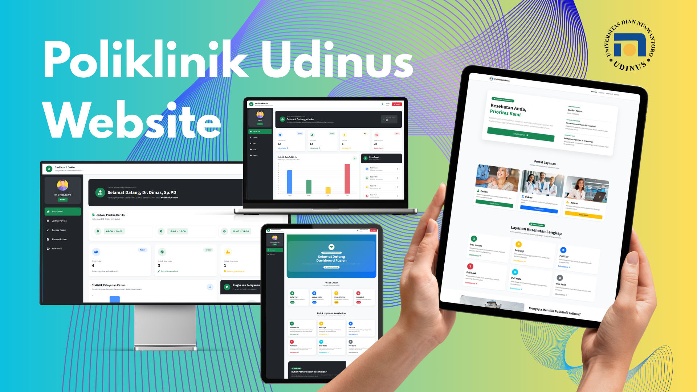

# Poliklinik Udinus

[](#)
[](#)
[](https://getbootstrap.com/)
[](#)
[](https://fontawesome.com/)
[](./LICENSE)

<p align="center">
  
</p>

Poliklinik Udinus is a full-stack clinical management and patient outpatient appointment web application engineered for the campus healthcare services of Universitas Dian Nuswantoro (UDINUS). Built to digitize physical polyclinic operations, the platform replaces manual paper-based registration logs, unstructured consultation queues, and fragmented prescription calculation with an automated, synchronized clinical workflow. The system unites outpatient services across specialized medical units, including General Medicine (*Poli Umum*), Dental Care (*Poli Gigi*), Pediatrics (*Poli Anak*), Ophthalmology (*Poli Mata*), Ear Nose & Throat (*Poli THT*), and Dermatology (*Poli Kulit*).

The application implements a secure, role-based architecture serving three distinct user personas: **Patients (*Pasien*)**, **Doctors (*Dokter*)**, and **Hospital Administrators (*Admin*)**. Patients can register personal accounts with automated Medical Record Number (*No. Rekam Medis*) generation, review real-time polyclinic schedules, register for consultations, obtain automated queue tickets, and inspect past examination summaries alongside prescribed medications and itemized billing statements. Practicing physicians manage practice timetables with built-in schedule collision prevention, access pending queue lists, record clinical diagnosis notes, and prescribe multiple pharmaceuticals through an automated billing engine. Simultaneously, administrators maintain full master data governance over medical personnel, polyclinic units, patient registries, and pharmaceutical pricing catalogs.

---

## Features

- **Multi-Role Authentication & Access Control**: Granular session-based security segregating access into three operational portals: Hospital Administrator, Practicing Doctor, and Outpatient.
- **Automated Medical Record Number (No. RM) Generator**: Dynamic algorithm that automatically generates standardized healthcare identification numbers in the format `YYYYMM-XXX` (e.g., `202412-001`) during patient registration, coupled with duplicate National Identity Number (NIK/No. KTP) validation.
- **Outpatient Polyclinic Registration & Dynamic AJAX Schedule Lookup**: Real-time consultation booking interface where selecting a medical department asynchronously fetches only verified active doctor schedules via background AJAX calls, eliminating full-page reloads.
- **Automated Queue Number Management**: Per-schedule queue sequencing that tracks existing registrations for a doctor's active shift and automatically assigns incremental queue numbers (`no_antrian`) to incoming patients.
- **Doctor Practice Timetable & Collision Prevention**: Shift scheduling module allowing physicians to define consultation days (`Senin` through `Sabtu`) and operational hours with automated overlap detection that blocks conflicting time slots across doctors within the same polyclinic department.
- **Single-Active Shift Constraint Enforcement**: One-click schedule activation mechanism that automatically deactivates a physician's alternative shifts, ensuring outpatient booking accurately reflects available consultation windows.
- **Clinical Examination & Multi-Medication Prescription Engine**: Medical recording interface where physicians input clinical diagnoses and prescribe multiple pharmaceutical items simultaneously via interactive multi-select checkboxes.
- **Automated Medical Billing Computation**: Transparent billing calculator that combines the standard medical consultation fee (IDR 150,000) with the exact sum of all prescribed medications, storing total expenses and itemized prescription details in the database.
- **Patient Medical History & Itemized Invoice Records**: Complete consultation archive enabling patients and attending physicians to review previous diagnoses, consultation dates, attending doctors, prescribed pharmaceuticals (aggregated via relational queries), and comprehensive billing statements.
- **Doctor Consultation Telemetry & Daily Workload Dashboard**: Physician command center featuring real-time daily shift reminders, queued vs. examined patient counters, dynamic consultation status bar charts, and completion progress gauges.
- **Administrative Master Data Governance**: Central management console providing end-to-end CRUD capabilities for Doctor profiles (with clinic affiliation), Polyclinic departments, Patient directories, and Pharmaceutical inventory with unit pricing in IDR.
- **Responsive Healthcare Interface**: Clean, accessible clinical UI built with Bootstrap 5.3.3 and Font Awesome 6, optimized for desktop administration consoles, clinical workstation tablets, and mobile patient self-service.

---

## Preview & Demo

The application's multi-role clinical workflows and administrative interfaces are showcased below:

### Multi-Role Polyclinic Ecosystem Overview


*Comprehensive Multi-Role Polyclinic Ecosystem: Integrated showcase displaying the Patient Appointment Booking form and real-time consultation queue history (top-center); Administrator Pharmaceutical Catalog management with packaging specifications and unit pricing (bottom-left); Doctor Clinical Examination modal with multi-medication selection and prescription toggles (bottom-right); and Patient Examination Invoice & Diagnosis Record modal showing clinical notes and prescribed medication chips (center-foreground).*

### Patient Self-Service Portal & Polyclinic Registration


*Patient Outpatient Experience: Patient Dashboard home featuring greeting banner, quick access shortcuts, polyclinic service catalog cards (*Poli Umum*, *Gigi*, *THT*, *Anak*, *Mata*, *Kulit*), and campus healthcare operating schedule (left); Polyclinic Appointment Registration portal with auto-filled Medical Record Number (*No. RM*), dynamic clinic dropdown, AJAX-driven schedule selector, chief complaint input, and registered queue status table with direct detail inspection (right).*

### Doctor Consultation Management & Clinical Examination Workflow


*Doctor Clinical Command Center: Physician home portal displaying assigned polyclinic badge, active shift time slots for the current day, patient workload metrics, consultation status distribution chart, and clinical progress gauge (left); Doctor Schedule Management interface with collision-free shift slots and active/inactive status toggles (top-right); and Patient Examination History modal presenting medical record metadata, clinical findings, and prescribed pharmaceutical badges (bottom-right).*

### Administrative Control Center & Master Data Management


*Hospital Administrator Control Center: Telemetry overview displaying comparative data distribution charts across registered patients, practicing doctors, polyclinic units, and medicine catalog items with quick navigation shortcuts (left); Polyclinic Department (*Poli*) directory with clinical scope descriptions and CRUD actions (top-right); and Pharmaceutical Pricing & Inventory directory managing drug packaging, unit pricing in IDR, and catalog modifications (bottom-right).*

---

## Tech Stack

### Core Architecture
- **Server-Side Runtime**: PHP 8.2+
- **Database Engine**: MySQL 8.0+ / MariaDB 10.4+
- **Database Driver**: PHP `mysqli` Extension (Procedural & Object-Oriented Interface)
- **Architecture Pattern**: Modular Multi-Page Web Application with Dedicated Component Architecture
- **Frontend Framework**: Bootstrap 5.3.3 (Responsive Grid, Modals, Forms, Utilities)
- **Client-Side Scripting**: Vanilla JavaScript (ES6+) with AJAX (`Fetch API` / `XMLHttpRequest` for dynamic dropdown resolution)
- **Iconography**: Font Awesome 6.5.1 & Bootstrap Icons 1.11.3
- **Typography**: Google Fonts (*Source Sans Pro* & *Poppins*)

### Tooling & Environment
- **Local Development Server**: Apache HTTP Server (via XAMPP, Laragon, or Docker) / PHP Built-in Server
- **Database Administration**: phpMyAdmin / MySQL CLI
- **Version Control**: Git & GitHub

---

## Prerequisites

Ensure the following runtimes and services are installed on your environment before setting up the application:

- **PHP**: Version 8.2 or later (Ensure `mysqli`, `session`, and `json` extensions are enabled in `php.ini`)
- **MySQL / MariaDB**: MySQL 8.0+ or MariaDB 10.4+
- **Web Server**: Apache HTTP Server (recommended via XAMPP, WAMP, or Laragon) or PHP Built-in Web Server (`php -S`)
- **Web Browser**: Modern Chromium, Firefox, or WebKit browser with JavaScript enabled

---

## Installation & Setup

Follow these verified steps to set up and run Poliklinik Udinus locally:

### 1. Clone the Repository

Clone the project repository to your web server root directory (e.g., `C:/xampp/htdocs/` on Windows or `/var/www/html/` on Linux):

```bash
git clone https://github.com/weztcy/Poliklinik-Udinus.git
cd Poliklinik-Udinus
```

### 2. Set Up the Database

1. Start your **MySQL** service through XAMPP, Laragon, or your local terminal.
2. Open your database administration tool (e.g., phpMyAdmin at `http://localhost/phpmyadmin` or the MySQL CLI).
3. Create a new database named `poli_bk`:

```sql
CREATE DATABASE poli_bk CHARACTER SET utf8mb4 COLLATE utf8mb4_general_ci;
```

4. Import the provided schema and seed dataset from `data/poli_bk.sql`:

```bash
# Using MySQL Command Line
mysql -u root -p poli_bk < data/poli_bk.sql
```

*(Alternatively, in phpMyAdmin, select the `poli_bk` database, navigate to the **Import** tab, choose `data/poli_bk.sql`, and click **Import**.)*

### 3. Verify Database Connection Configuration

Inspect `config/koneksi.php` and verify that the database credentials match your local MySQL configuration:

```php
<?php 
$databaseHost = 'localhost';
$databaseName = 'poli_bk';
$databaseUsername = 'root';
$databasePassword = '';
 
$mysqli = mysqli_connect($databaseHost, 
    $databaseUsername, $databasePassword, $databaseName);

if (!$mysqli) {
    die("Koneksi gagal: " . mysqli_connect_error());
}
?>
```

---

## Environment Variables

The application manages database connectivity via `config/koneksi.php`. The following parameters define the database environment:

| Variable | Description | Default Value | Required |
| :--- | :--- | :--- | :--- |
| `$databaseHost` | Hostname or IP address of the MySQL server | `localhost` | Yes |
| `$databaseName` | Name of the polyclinic relational database | `poli_bk` | Yes |
| `$databaseUsername` | MySQL user account for executing queries | `root` | Yes |
| `$databasePassword` | Password corresponding to the MySQL user account | `""` *(empty string)* | Optional |

---

## Usage / Running the Project

### Starting the Application

#### Option A: Using Apache (XAMPP / Laragon)
1. Move the `Poliklinik-Udinus` folder into your server's web root (`htdocs` or `www`).
2. Start Apache and MySQL modules.
3. Open your browser and navigate to:
   ```text
   http://localhost/Poliklinik-Udinus/
   ```

#### Option B: Using PHP Built-in Server
Open your terminal inside the project root directory and start the local development server:

```bash
php -S localhost:8000
```

Access the application in your browser at:
```text
http://localhost:8000
```

---

### Default Credentials & User Roles

The database dump (`data/poli_bk.sql`) includes pre-configured seed accounts for all three user roles:

#### 1. Administrator Portal
- **Login URL**: `http://localhost:8000/login.php?role=Admin`
- **Username**: `Admin`
- **Password**: `Admin123`
- **Permissions**: Manage Doctors, Polyclinic Departments, Medicine Catalog, and Patient Records.

#### 2. Doctor Portal (*Dokter*)
- **Login URL**: `http://localhost:8000/login.php?role=dokter`
- **Username**: `Dr. Dimas, Sp.PD`
- **Password**: `Dr. Dimas, Sp.PD`
- *Alternative Seed Doctors*: `Dr. Aulia Sari, Sp.PD`, `Dr. Budi Santoso, Sp.OG`, `Dr. Citra Dewi, Sp.A`
- **Permissions**: Manage Practice Schedules, Examine Queued Patients, Prescribe Medications, and Inspect Clinical Histories.

#### 3. Patient Portal (*Pasien*)
- **Login URL**: `http://localhost:8000/loginUser.php`
- **Username**: `Kevin Sanjaya Putra`
- **Password**: `user123`
- *Registration URL*: `http://localhost:8000/register.php` (Self-registration with auto-generated No. RM)
- **Permissions**: Register for Polyclinic Visits, Obtain Queue Tickets, View Examination Notes, and Review Prescription Billing.

---

## API Reference / Documentation

The application exposes dedicated server endpoints and asynchronous handlers to support dynamic client interactions:

### Dynamic Schedule Resolution (AJAX)

Fetches active doctor consultation schedules based on the selected polyclinic department.

- **Endpoint**: `POST /getJadwal.php`
- **Headers**: `Content-Type: application/x-www-form-urlencoded`
- **Parameters**:
  - `poliId` *(integer, required)*: The unique primary key ID of the selected polyclinic department.
- **Response**: HTML formatted `<option>` elements containing doctor names, shift days, and start/end times.
- **Example Request**:
  ```http
  POST /getJadwal.php HTTP/1.1
  Host: localhost:8000
  Content-Type: application/x-www-form-urlencoded

  poliId=10
  ```
- **Example Response (Success)**:
  ```html
  <option value='23'>Dr. Dimas, Sp.PD - Kamis 08:00 - 10:00</option>
  <option value='8'>Dr. Budi Santoso, Sp.OG - Senin 11:00 - 16:00</option>
  ```
- **Example Response (No Active Schedules)**:
  ```html
  <option value=''>Jadwal tidak ditemukan</option>
  ```

### Key Application Controllers

- `pages/login/checkLogin.php`: Validates credentials for Administrator and Doctor accounts against the `dokter` table using MD5 password hashing.
- `pages/loginUser/checkLoginUser.php`: Validates Patient authentication against the `pasien` table and initializes session states (`$_SESSION['no_rm']`, `$_SESSION['id']`).
- `pages/register/checkRegister.php`: Validates unique KTP numbers, increments monthly sequential numbers, and registers new patient records with formatted Medical Record numbers (`YYYYMM-XXX`).
- `pages/daftarPoli/daftarPoli.php`: Calculates incremental queue numbers for the selected consultation schedule and stores patient appointment registrations.
- `pages/periksaPasien/periksaPasien.php`: Records physician examination notes, logs prescribed medications to `detail_periksa`, calculates total examination fees (base fee + medicine costs), and updates examination completion statuses.
- `pages/jadwalPeriksa/tambahJadwal.php`: Validates schedule boundaries against existing doctor shifts in the same polyclinic unit before inserting new consultation hours.

---

## Build & Deployment

Poliklinik Udinus is designed for deployment on standard LAMP/LEMP production stacks (Linux, Apache/Nginx, MySQL/MariaDB, PHP).

### Production Considerations

1. **Web Server Root Configuration**:
   Configure Apache `VirtualHost` or Nginx `server` block to route requests directly to the repository root directory.
   ```apache
   <VirtualHost *:80>
       ServerName poliklinik.udinus.ac.id
       DocumentRoot "/var/www/poliklinik-udinus"
       <Directory "/var/www/poliklinik-udinus">
           AllowOverride All
           Require all granted
       </Directory>
   </VirtualHost>
   ```

2. **File Permissions**:
   Ensure web server read permissions across all PHP scripts and asset directories:
   ```bash
   chown -R www-data:www-data /var/www/poliklinik-udinus
   find /var/www/poliklinik-udinus -type f -exec chmod 644 {} \;
   find /var/www/poliklinik-udinus -type d -exec chmod 755 {} \;
   ```

3. **Database Hardening**:
   - Create a dedicated MySQL user with constrained permissions specifically for the `poli_bk` database rather than utilizing root credentials.
   - Update `config/koneksi.php` with the production database credentials.

4. **Security Enhancements**:
   - Enforce HTTPS across all application routes using TLS certificates.
   - For enterprise production deployments, consider upgrading legacy MD5 password hashing to PHP's native `password_hash()` with `PASSWORD_BCRYPT` or `PASSWORD_ARGON2ID`.

---

## License

Please see the [LICENSE](./LICENSE) file for the terms and conditions governing the use, modification, and distribution of this project.

## Author & Contact

**Yohanes Dimas Pratama**

- GitHub: [github.com/weztcy](https://github.com/weztcy)
- Portfolio: [dimaspratama.vercel.app](https://dimaspratama.vercel.app)
- LinkedIn: [linkedin.com/in/yohanes-dimas](https://www.linkedin.com/in/yohanes-dimas)

